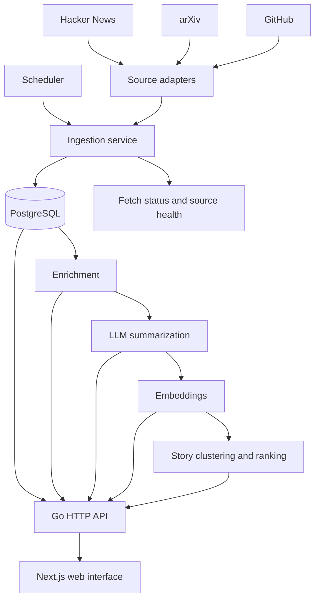

# Synergy

**Synergy is a personal AI-development intelligence agent.** The web interface is how you interact with it; the core project is an ingestion and intelligence pipeline, not just a website.

- **Live interface:** https://synnergyy.netlify.app/
- **Backend API:** https://synergy-v1-9rnl.onrender.com
- **Repository:** https://github.com/Nakshatra-thange/news-agent

## What it does

- Collects information from Hacker News, arXiv, and GitHub through source-specific adapters.
- Uses a configurable scheduler to check which sources are due.
- Stores registered sources and collected items in PostgreSQL.
- Exposes an HTTP API for the frontend.
- Includes pipeline commands for enrichment, LLM-based summarization, embeddings, and story clustering.

Default sources:

| Source | Focus |
|---|---|
| Hacker News | AI discussions, tools, and research |
| arXiv | Papers in `cs.AI`, `cs.LG`, and `cs.CL` |
| GitHub | New repositories related to LLMs, AI agents, and generative AI |

## Architecture



### Components

1. **Source adapters:** Fetch and interpret information from each upstream service.
2. **Ingestion service:** Runs fetches with timeouts, rate limiting, duplicate handling, and fetch-run tracking.
3. **Scheduler:** Runs inside the API service when enabled. It checks sources periodically; each source's minimum fetch interval controls when it is eligible.
4. **PostgreSQL:** Persists sources, collected items, and pipeline state.
5. **Intelligence pipeline:** CLI commands support enrichment, LLM summaries, embeddings, and clustering related items into stories. Real provider calls require the corresponding API keys.
6. **Go API and Next.js UI:** The API exposes data. Next.js rewrites `/api/v1/*` requests to the backend, so the browser can use same-origin API paths.

## Tech stack

- **Backend:** Go
- **Database:** PostgreSQL
- **Frontend:** Next.js, React, TypeScript
- **Deployment:** Render (API), Neon (PostgreSQL), Netlify (web interface)
- **Optional AI providers:** Anthropic or OpenRouter for summaries; Voyage AI for embeddings

## Local development

### Prerequisites

Go compatible with the `go.mod` toolchain, Node.js/npm, and PostgreSQL.

### 1. Configure the backend

From the repository root:

```bash
cp .env.example .env
```

Edit `.env` and set `DATABASE_URL` to your local PostgreSQL database. Keep `.env` out of version control and never commit credentials.

Apply migrations and register sources:

```bash
go run ./cmd/synergy migrate up
go run ./cmd/synergy seed
```

### 2. Start the API

```bash
go run ./cmd/synergy serve
```

The default local API address is `http://127.0.0.1:8080`.

### 3. Start the frontend

In another terminal:

```bash
cd web
npm install
npm run dev
```

Open `http://localhost:3000`. The default API target is `http://127.0.0.1:8080`; set `SYNERGY_API_URL` when you need to override it.

## CLI commands

Run commands through `go run ./cmd/synergy`:

| Command | Purpose |
|---|---|
| `serve` | Run the HTTP API and enabled scheduler |
| `migrate up` | Apply database migrations |
| `seed` | Register default sources; safe to run repeatedly |
| `fetch --all --force` | Fetch all active sources immediately, bypassing source cooldowns |
| `enrich --fake` | Enrich items using the offline fake provider |
| `summarize --fake` | Summarize using the offline fake provider |
| `embed --fake` | Create embeddings using the offline fake provider |
| `cluster --fake` | Run clustering using the offline fake provider |

For command-specific help:

```bash
go run ./cmd/synergy help
go run ./cmd/synergy fetch --help
```

The scheduler checks due sources when `SCHEDULER_ENABLED=true`. To trigger fetching manually:

```bash
go run ./cmd/synergy fetch --all --force
```

## Configuration

See [`.env.example`](.env.example) for the full list. Important variables include:

| Variable | Purpose |
|---|---|
| `DATABASE_URL` | PostgreSQL connection string |
| `SERVER_HOST`, `SERVER_PORT` | API listener address |
| `SCHEDULER_ENABLED` | Enable scheduled fetching |
| `SCHEDULER_INTERVAL` | Scheduler check interval |
| `GITHUB_TOKEN` | Optional GitHub token for higher rate limits |
| `ANTHROPIC_API_KEY` | Optional Anthropic summarization key |
| `OPENROUTER_API_KEY` | Optional alternative summarization provider |
| `VOYAGE_API_KEY` | Optional embeddings key |

Configure production secrets in the hosting provider's environment settings. The local `.env` and Render's `DATABASE_URL` are separate: verify which database a command targets before running migrations, seeding, or ingestion.

## API quick checks

- [Registered sources](https://synergy-v1-9rnl.onrender.com/api/v1/sources)
- [Items](https://synergy-v1-9rnl.onrender.com/api/v1/items)

The API root may return `not_found` because the service exposes versioned API routes rather than a homepage.

## Project status

Synergy is deployed with a Go API, PostgreSQL-backed sources, and a Next.js interface. The current source adapters cover Hacker News, arXiv, and GitHub. AI pipeline stages depend on their provider configuration.

## Contributing

1. Create a branch for your change.
2. Keep credentials and local environment files out of commits.
3. Run relevant Go tests and frontend checks before opening a pull request.

## License

No license is specified yet. Add a `LICENSE` file before presenting the project as open source for reuse.
